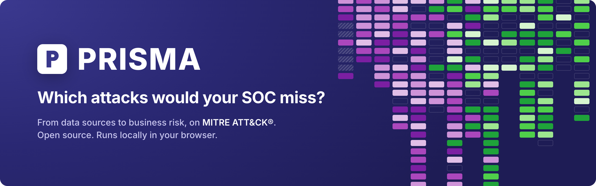
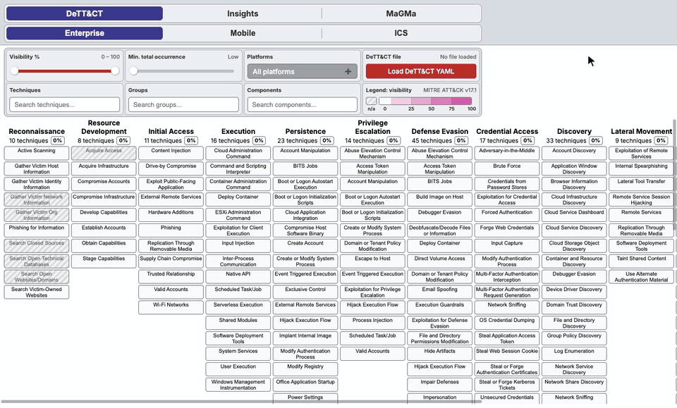
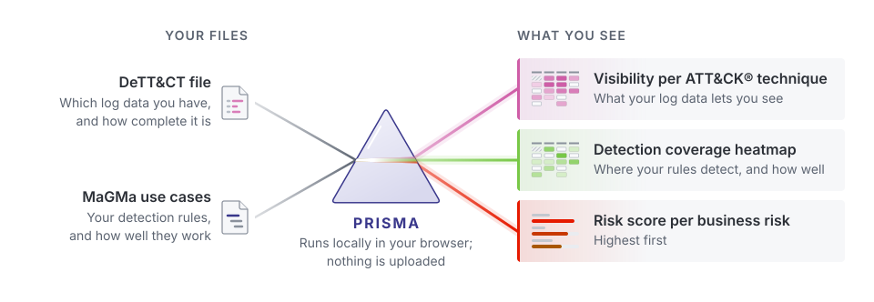
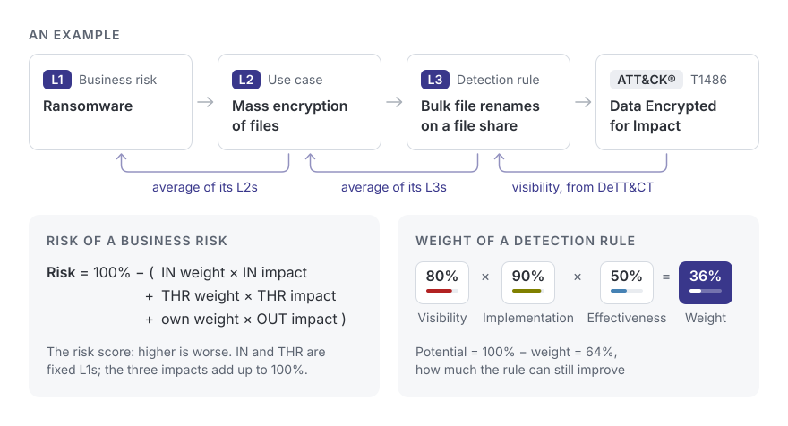

<h1></h1>

<p align="center">
  <a href="https://github.com/jongstra/PRISMA/actions/workflows/ci.yml"></a>
  
  <a href="LICENCE"></a>
  <br>
  <sub>Prioritized Risk Indicator for Security Monitoring &amp; Analysis</sub>
</p>

PRISMA shows which business risks, such as ransomware, your security monitoring covers least, and where there is most room to improve. It calculates this from two things your security team maintains: the log data you collect, described with [DeTT&CT](https://github.com/rabobank-cdc/DeTTECT) (an open-source method to score log sources), and your detection rules, which you build and score in PRISMA following the [MaGMa use case framework 2.0](docs/MaGMa%202.0%20functional%20documentation%20EN.pdf) (a method that links detection rules to business risks). Both are mapped onto MITRE ATT&CK®, the standard catalogue of attack techniques. PRISMA is open source and runs locally in your browser: no backend, no account, and your files stay on your computer.


*A fictional organisation. Ransomware has the highest risk score: 71% (higher is worse). Use the score to rank risks and to track progress: it is not a measured probability, and not the chance that an attack succeeds, although the picture's title still says "chance". It is calculated from the organisation's own description of its log data and its own scoring of its detection rules. [How it is calculated](docs/calculations.md).*


*Why: in this example the steps inside the network count for 65% in the ransomware score, and detection there is weak: about 1% of moving between machines (Lateral Movement) is covered, against 21% of getting in (Initial Access). Remote Services shows the cause: about half the needed log data is collected, and its two rules give many false alarms and are little tested. A technique without a rule counts as 0%, so a tactic's score is low unless most of its techniques have a rule.*

## What you get

- **The risks your monitoring covers least.** Each business risk, such as ransomware, gets a risk score from your log data and your rules.
- **Where you are blind.** Visibility per ATT&CK technique, from the log data you collect.
- **Where the most room is.** Each detection rule is scored on visibility, implementation and effectiveness, and PRISMA suggests the log data that would help most.

## Who it is for

**For security teams:** score your rules, see where coverage is thinnest, and choose the next improvement.<br>
**For CISOs, managers and boards:** a ranked overview for a budget or board discussion. Ask: which risk scores highest, why, and what are the first three fixes? Bring the ranking and the trend to the board, not the single number.

## What the numbers are, and are not

- The risk score ranks risks; it does not predict how many attacks go unseen. Compare it over time; do not quote it as an absolute. (It is 100% minus a weighted average of how well your rules cover each phase of an attack.)
- Prevention, response, and the likelihood and cost of an attack are outside it.
- Implementation (false positives) and effectiveness (testing) are scores your team enters. PRISMA does not test rules or check your scores.
- Visibility uses only the device completeness score of your DeTT&CT file, averaged over a technique's data components. The other data quality scores are not used, and if a data source has several entries, only the first is read.
- A missing score counts as 0%, so a half-filled file looks worse than it is.

All choices in the model are in the [calculations guide](docs/calculations.md).

**Status:** pre-release. There is no tagged version, hosting guide or vulnerability contact yet. The calculations are covered by automated tests; expect rough edges in the interface.

## Try it

1. Start PRISMA on your computer: see the [installation instructions](#installation-instructions) (Node.js, then `npm ci` and `npm run dev` in `frontend/`).
2. On the DeTT&CT page, load [`examples/dettect/demo.yaml`](examples/dettect/demo.yaml) with **Load DeTT&CT YAML**. Then, on the MaGMa page, load [`examples/magma/demo.yaml`](examples/magma/demo.yaml) with **Load MaGMa YAML**.
3. Open **Summary** on the MaGMa page: you see the first picture above.

Do not refresh the page: without the DeTT&CT file most risks show 100%.



*From two files to the answer, in 16 seconds.*

## Using it with your own data

You need two things:

1. **A DeTT&CT data source file:** which log data you collect, and on how many of your systems (a score from 0 to 5 per data source). You can make it with the [DeTT&CT Editor](https://rabobank-cdc.github.io/dettect-editor/#/datasources). PRISMA reads data source files only, not technique administration files.
2. **Your MaGMa use cases, built in PRISMA:** on the MaGMa page, the L1, L2 and L3 sheets hold your business risks, use cases and detection rules, and work like a spreadsheet. Each rule gets at most one ATT&CK technique and two scores from 0 to 100, implementation and effectiveness. Section 3.3 of the [MaGMa 2.0 documentation](docs/MaGMa%202.0%20functional%20documentation%20EN.pdf) says how to score them; implementation can be measured from your alert handling, as 100% minus the share of a rule's alerts that were false positives. For each business risk you also set how much each phase of an attack counts: getting in, moving inside and reaching the goal (together 100%). **Save MaGMa YAML** keeps it all in one file, which you load again next time.

Already working in Excel? Copy and paste between Excel and the sheets, or convert the [MaGMa Excel template](templates/) or a list of rules (name, implementation, techniques) with the scripts in [`tools/`](tools/) (the columns are in [data formats](docs/data-formats.md#excel-files)). There is no Sigma or SIEM import. As an indication of size, not of time: the demo has 57 data sources (the largest example here has 110) and 62 detection rules.

PRISMA keeps no history, and a reload clears what you loaded. Save your use cases with **Save MaGMa YAML** while you work, keep the file with the DeTT&CT file you loaded, and load an older pair to compare.

## How it works

<picture>
  <source media="(prefers-color-scheme: dark)" srcset="docs/images/prism-dark.svg">
  
</picture>

Improving detection is a loop:

1. Collect log data. PRISMA turns it into visibility per ATT&CK technique.
2. Build and score your detection rules. PRISMA gives each rule a weight: how well it covers its technique.
3. See the risk score per business risk.
4. Pick what to improve: more log data, or better rules. This is your decision; PRISMA shows where the most room is.

PRISMA calculates steps 1 to 3, so you can see what step 4 should be. Where PRISMA fits among DeTT&CT, your SIEM or EDR and MaGMa: see the [architecture guide](docs/architecture.md#where-prisma-fits).

<picture>
  <source media="(prefers-color-scheme: dark)" srcset="docs/images/hierarchy-dark.svg">
  
</picture>

*The calculation, from business risk to detection rule.*

PRISMA uses MITRE ATT&CK® v17.1 for Enterprise, Mobile and ICS. Version 18 and later are not supported yet. The MaGMa 2.0 documentation is in [`docs/`](docs/), with guides to PRISMA's [calculations](docs/calculations.md), [architecture](docs/architecture.md) and [files](docs/data-formats.md).

## Security and privacy

- PRISMA is a static web page: there is no backend, no account and no database. `npm run dev` only serves the page to your own computer.
- The files you load are read in your browser and are not sent anywhere. The only request the app makes is to its own address, for the ATT&CK catalog.
- The browser stores nothing: no cookies and no local storage. Reloading the page clears your work; keep it with **Save MaGMa YAML**.
- PRISMA does not connect to your SIEM, EDR or CMDB.

Your two files describe where your detection is weak. Store and share them as sensitive information.

## What's in this repository

| Name | Description |
|---|---|
| [`.github/`](.github/) | The checks GitHub runs on every push to main and every pull request (`workflows/ci.yml`), and Dependabot's settings |
| [`docs/`](docs/) | MaGMa 2.0 functional documentation, and guides to PRISMA's calculations, structure and files |
| [`examples/`](examples/) | Example DeTT&CT and MaGMa files to try the app |
| [`frontend/`](frontend/) | The PRISMA web application |
| [`templates/`](templates/) | MaGMa Excel template, for preparing many use cases |
| [`tools/`](tools/) | A notebook that builds the ATT&CK catalog, and scripts that convert Excel files |
| [`LICENCE`](LICENCE) | Licence of this project. MITRE's licence for the ATT&CK data in the catalog and the MaGMa template is in [`frontend/public/LICENCE-ATTACK.txt`](frontend/public/LICENCE-ATTACK.txt) |

## Installation Instructions

### Install Node.js
If you do not have Node.js installed, please [download](https://nodejs.org/en/download) and install it. After this step, it is assumed that you have Node.js installed with npm as the package manager.

**Note:** PRISMA needs Node.js 22.22 or newer: version 22 (from 22.22), 24 (from 24.15), or 26 and later. It was last tested with Node.js v26.10.0 (October 2026). You can check your installed version with `node -v`.

### Clone this Repository
```sh
git clone git@github.com:jongstra/PRISMA.git
```
If you don't have SSH keys set up for GitHub, clone via HTTPS instead:
```sh
git clone https://github.com/jongstra/PRISMA.git
```

### Enter Project Frontend Directory
```sh
cd PRISMA/frontend
```

### Install Application and Dependencies
```sh
npm ci
```
This performs a clean install of all dependencies, exactly as pinned in `package-lock.json` (any existing `node_modules` folder is removed automatically).

**Troubleshooting `npm ci` errors:**
- If it says that `package.json` and `package-lock.json` are out of sync, `package.json` was changed by hand: undo that with `git checkout -- package.json`. Don't run `npm install` to fix it: that rewrites `package-lock.json`, and with it the tested versions.
- Make sure your Node.js version is recent enough — see the note under *Install Node.js*.

### Run Application (for Development & Testing)
```sh
npm run dev
```

- To use the application, open the link shown in your terminal (something like `localhost:5173`) in your browser.
- Then follow [Try it](#try-it), or [Using it with your own data](#using-it-with-your-own-data). More examples are in [`examples/`](examples/).

## Development
- Software Development: Thomas Jongstra
- Conceptual Guidance: Rob van Os
- Overarching project (an inventory of cyber resilience capabilities across government departments): Rob van Os, Raymond Bierens & Tony van der Togt

## Technical Setup
- Web app: Vue 3 and TypeScript (Pinia, Vite); see [Security and privacy](#security-and-privacy).
- Dependencies: eight runtime packages, pinned in `package-lock.json`. Dependabot proposes updates monthly, and every change is built and tested on Node.js 22, 24 and 26.
- Tools: a Python notebook that builds the ATT&CK catalog, and Python scripts that convert Excel files to MaGMa YAML.

## Future
- This project has a strong focus on pragmatism and simplicity for the benefit of the end user. Its design is sometimes strongly opinionated and limited with this goal in mind. New features may be added based on common user needs, but should not undermine this philosophy.

## Thanks
Thanks are extended to the following:
- Dutch Government: The initial development of this project has been funded by the Dutch government. This support has been instrumental for the creation of this project.
- The MITRE Corporation: This project builds on the work of MITRE which provides up-to-date ATT&CK mappings. These mappings form a crucial basis for this project.
- Developers of DeTT&CT: This project extends the work in DeTT&CT and would not have existed without it.
