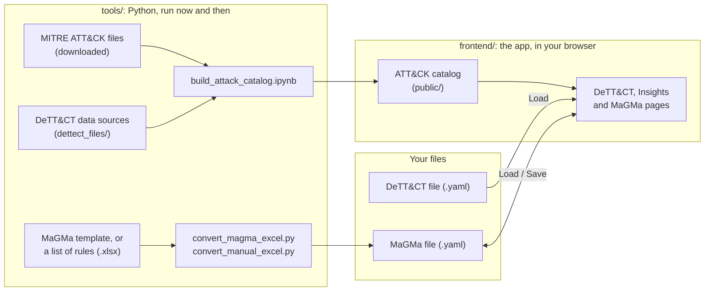

# How PRISMA is built

PRISMA is a web app that runs entirely in your browser: the files you load are read there and are not sent anywhere. A few Python tools prepare its data beforehand. How PRISMA calculates is in [calculations.md](calculations.md), and its files are described in [data-formats.md](data-formats.md).

## The big picture

- **The ATT&CK catalog** is built once per ATT&CK version and is part of the repository. The app loads it when it starts.
- **Your own data**, a DeTT&CT file and MaGMa use cases, is loaded with the buttons on the pages. MaGMa work is kept by saving it as a file (**Save MaGMa YAML**); the browser stores nothing.

## The app (`frontend/src/`)

Each layer has one job:

| Layer | Folder | Job |
|---|---|---|
| Pages | `views/` | The three pages, each built from components |
| Components | `components/` | What you see and click, grouped by page (`attack/`, `insights/`, `magma/`), plus shared ones (`common/`) |
| Shared data | `stores/` | The data all pages use: the catalog and the DeTT&CT visibility (`tactics.ts`), and the MaGMa use cases (`magma.ts`) |
| Calculations | `domain/` | Visibility, scores, risk and checks, without user interface, each with tests |
| Files | `io/` | Reading and writing files: the catalog, DeTT&CT and MaGMa files, downloads |

`App.vue` is the frame around the pages (navigation and domain buttons) and loads the catalog; `router/` connects the addresses to the pages. How to run, test and build the app is in [`frontend/README.md`](../frontend/README.md).

Three agreements keep it this way:

- Calculations and checks go in `domain/`, with a test in the `__tests__/` folder next to them.
- Reading and writing files goes in `io/`. Stores never show messages; components do.
- Every folder has a README with a table of its files. Update it when you add, remove or rename a file.

**Example: loading a MaGMa file.** The **Load MaGMa YAML** button (`SheetTabs.vue`) reads and checks the file with `io/`, asks before replacing use cases, and hands them to the store (`stores/magma.ts`). The store recalculates everything with `domain/magma/calculations.ts`, and the sheets, heatmap and charts update by themselves.

## The tools (`tools/`)

| Tool | When to use it |
|---|---|
| `build_attack_catalog.ipynb` | For a new ATT&CK version: downloads MITRE's files, and builds, checks and writes the catalog |
| `convert_magma_excel.py` | To turn a filled-in MaGMa template into a MaGMa file for PRISMA |
| `convert_manual_excel.py` | To turn a simple list of detection rules into a MaGMa file for PRISMA |

The setup and commands are in [`tools/README.md`](../tools/README.md).
